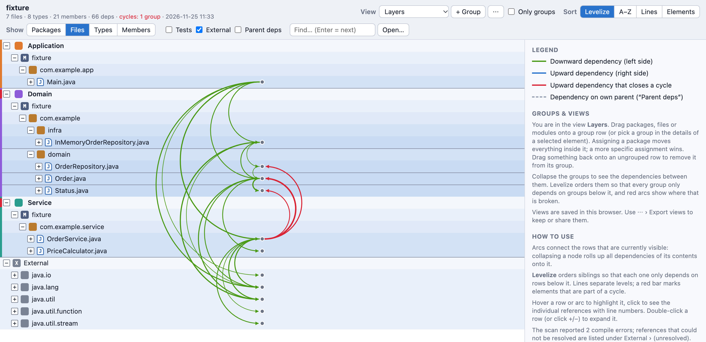

# depviewer

See the real dependency structure of your code base, and check it against the architecture your
team intended.

depviewer scans a Java, Kotlin, TypeScript/JavaScript or Dart project and turns it into a single
HTML page: your code as a tree (module › package › file › type › member) with every dependency
drawn as an arc. It orders the code by its dependencies, highlights cycles, and lets you draw your
architecture — layers, components, bounded contexts — as groups on top of the real code. Every
arc that goes against the order you defined stands out.

<picture>
  <source media="(prefers-color-scheme: dark)" srcset="docs/screenshot-dark.png">
  
</picture>

*The bundled example in a "Layers" view: green arcs are downward dependencies; the red arcs show
`Domain` depending back on `Service`, a cycle inside `Core`.*

## Why

- **Find what erodes the design:** cycles and layer violations at package, file, type or member
  level, down to the exact `file:line`.
- **Agree on the architecture:** draw it as views and groups in the browser, export them, commit
  them next to the code, and everyone opens the same picture.
- **Share without setup:** the result is one self-contained HTML file that works offline. No
  server, no account, no plugin; scanning needs only a JDK.

## Try it

```sh
git clone https://github.com/flbaue/depviewer.git && cd depviewer
./depviewer -o myproject.html path/to/your/project
open myproject.html
```

The **[quick start](docs/quick-start.md)** walks you through the example project, reading the arcs,
finding cycles and drawing your architecture as groups.

## Documentation

- [Quick start](docs/quick-start.md): from zero to your first architecture view.
- [Usage](docs/usage.md): command line, what gets scanned, classpath, output files.
- [Supported languages](docs/languages.md): how each language is analysed, toolchains and limits.
- [The viewer](docs/viewer.md): every feature of the viewer, views and groups.
- [Specs](docs/specs/): detailed behaviour, for contributors.

## AI notice

This project was written almost entirely by an AI coding agent
([Claude Code](https://claude.com/claude-code)) under the direction of its human maintainer.
Review it like any third-party code before you rely on it. [How it was built](docs/how-it-was-built.md).

## Contributing

Issues and pull requests are welcome, from humans and AI-assisted alike. See
[CONTRIBUTING.md](CONTRIBUTING.md) and the technical guide [AGENTS.md](AGENTS.md); run
`scripts/check.sh` before opening a pull request.

## License

MIT, see [LICENSE](LICENSE).
