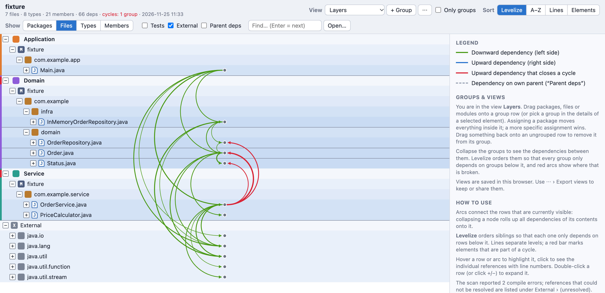

# Quick start

From zero to "where are the cycles in my code?" in about five minutes. The reference docs are
[usage](usage.md), [languages](languages.md) and [the viewer](viewer.md).

## 1. What you need

- **JDK 17 or newer** (`java -version`). That is all for Java and Kotlin projects.
- **Node.js 18+** for TypeScript/JavaScript, **Dart SDK 3.11+** (or Flutter) for Dart. Languages
  whose toolchain is missing are skipped with a note, so a mixed repository still works.
- A browser. The viewer is a single HTML file that works offline.

```sh
git clone https://github.com/flbaue/depviewer.git
cd depviewer
```

There is nothing to build: the `depviewer` script compiles the scanner on first use.

## 2. Try it on the example

```sh
./depviewer -o example-fixture.html --views test/fixture-views.json test/fixture
open example-fixture.html          # Linux: xdg-open example-fixture.html
```

This is a small Java + Kotlin project with a deliberate cycle and a ready-made "Layers" view, so
you can see every feature before scanning your own code. The scan prints a note about 13 Java
compile errors: that is expected here (the example has no JUnit jars, and Java code refers to
Kotlin code, which is matched by name).

## 3. Scan your project

```sh
./depviewer -o myproject.html path/to/myproject
open myproject.html
```

- Point it at the project root. It finds Maven/Gradle source folders (`src/main/java`,
  `src/main/kotlin`, …), `package.json` folders and `pubspec.yaml` folders by itself. Several
  directories can be given at once.
- `--no-tests` leaves out test sources. `--title "My project"` sets the title shown in the viewer.
- **Java libraries**: types from libraries resolve when their jars are found. Run
  `mvn dependency:copy-dependencies` first, or pass `--cp <classpath>`. Without them, library
  references end up under *External › (unresolved)* and the scan prints a note with the number
  of compile errors; dependencies between your own classes are still found.
- **Dart/Flutter**: run `dart pub get` / `flutter pub get` in your project first.
- Large projects take up to about a minute to scan.
- All options and what gets scanned: [usage](usage.md); per-language details: [languages](languages.md).

## 4. Read the picture

<picture>
  <source media="(prefers-color-scheme: dark)" srcset="screenshot-dark.png">
  
</picture>

- **Left:** your code as a tree: module › package › file › type › member. Each row has a dot in
  the arc column.
- **Arcs** connect rows that depend on each other. The arrow points at the dependency.
  - **Green, left side:** downward dependency. This is the normal direction.
  - **Blue, right side:** upward dependency.
  - **Red, right side:** upward dependency that closes a **cycle**. Rows that are part of a cycle
    get a red bar on their left edge.
- **Collapsed rows roll up** everything inside them: the arcs of a collapsed package are the
  dependencies of all its files.
- **Levelize** (the default sort) puts every element above the elements it depends on. Lines
  between rows separate levels. In a clean design almost all arcs are green.
- The header shows totals and how many cycles there are, at which level.

## 5. Explore

| To… | Do this |
|---|---|
| Change the detail level | **Show:** Packages · Files · Types · Members |
| Open or close one row | Click **+ / −**, or double-click the row |
| See what a row uses and what uses it | **Hover** the row; its arcs and related rows light up |
| See the individual references | **Click** a row or an arc. The panel on the right lists every reference with kind and file:line. Click one to jump there |
| Find an element | Type in **Find…**, then **Enter** for the next match (**Shift+Enter** for the previous) |
| Sort differently | **Sort:** Levelize · A–Z · Lines · Elements (lines of code / number of types and members) |
| Hide noise | Untick **Tests** and **External** (JDK and library types); tick **Parent deps** to also see members using their own class |
| Clear the selection | **Esc** |

A good first tour: start at **Packages**, look for red arcs and red bars, click a red arc to see
exactly which references cause the cycle, then switch to **Files** or **Types** to narrow it down.

## 6. Draw your architecture with views and groups

The physical package structure is often not how you think about the code. A **view** lets you
regroup it, for example into layers, without changing the code:

1. Click **+ Group**. This creates a view and an empty group, with its name ready to edit: type a
   name (e.g. *Domain*) and press **Enter**. Later, hover the group row and click **Rename**.
2. **Drag** packages, files or modules onto the group row, or select an element and pick a group
   in the panel. A package takes everything inside it along; a more specific assignment wins.
3. Add more groups (*Application*, *Infrastructure*, …). **+ Sub** on a group row nests groups,
   e.g. *Core* containing *Domain* and *Service*.
4. **Collapse the groups.** Levelize now orders your layers, and every red or blue arc between
   them is a dependency that goes against your intended architecture. Tick **Only groups** to hide
   everything you have not assigned yet.

To undo an assignment, drag the element back onto an ungrouped row. Use the **⋯** menu to create,
copy, rename or delete views; keep several, e.g. one for layers and one for features.

## 7. Save and share

- Views are saved in your browser automatically, per project title.
- **⋯ › Export views** writes them to a JSON file. Commit it next to your code, and embed it when
  you scan, so everyone opens the HTML with your views already in place:

  ```sh
  ./depviewer -o myproject.html --views myproject-views.json path/to/myproject
  ```

- The generated HTML contains everything and works offline: send it, attach it to a ticket or
  publish it as a CI artifact. It contains your class and member names, so share it like source
  code.
- `-o deps.json` writes only the data. Open it in `viewer.html` with **Open…** or by dragging the
  file onto the page.

## Tips

- Add `?level=1` … `?level=4` to the HTML's URL to open it at Packages, Files, Types or Members.
- Kotlin references are resolved by name, so a few can be missing; Java, TypeScript and Dart are
  resolved by their compilers. Details are in the [requirements wiki](../spec/).
- Something looks wrong? Please open an issue with a small snippet that reproduces it.
